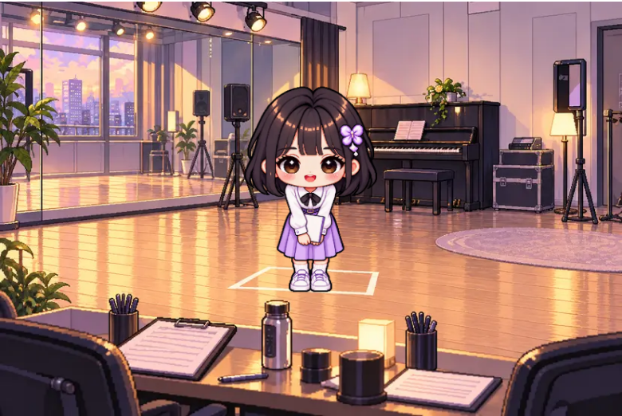

# 이미지 적용 · 2026-11-02

현재 ENCORE v2에 완성된 이미지를 연결했습니다. 게임 엔진·이벤트 발생 조건·능력치·정산·저장 형식은 변경하지 않았습니다. 배포와 커밋은 실행하지 않았습니다.

- 배경 32종과 이벤트 캐릭터 372장을 분리된 레이어로 표시합니다.
- 캐릭터 선택·홈·프로필·기록은 개별 캐릭터 PNG를 사용합니다. 기존 시트에서 이웃 캐릭터를 잘라 쓰지 않습니다.
- 이벤트 선택·결과·계약·주요 기록 화면은 선택한 캐릭터의 의상과 동작을 표시합니다.
- 이벤트는 두 프레임이 모두 로드되면 600ms씩 교체합니다. 프로필과 선택 화면은 눈을 뜬 원본 4,074ms와 완전히 감은 전용 프레임 126ms를 교체합니다. 프레임별 발 위치와 실제 캐릭터 높이를 맞추고 모션 감소 설정에서는 첫 프레임만 표시합니다.
- 입대 군복은 남성 3·4·5, 위문공연 의상은 여성 0·1·2만 사용합니다. 성별에 맞지 않는 장면은 휴식 또는 축제 이미지로 안전하게 대체합니다. 게임 이벤트 조건은 변경하지 않았습니다.
- 현재 v2에는 상점이 없어 아이템 12종 × 두 변형을 관련 활동 선택지의 장비 그림으로 연결했습니다. 구매 기능이나 능력치 효과를 새로 만들지 않았습니다.
- Next Image로 화면 크기에 맞게 이미지를 전달하며 원본 PNG는 그대로 보존합니다.

## 미완성 이미지 처리

2026-11-03에 남은 15장 제작을 완료해 이벤트용 372장 / 186세트 / 32개 상황이 모두 완성되었습니다. 기본 노래 동작으로 대체하던 앨범 녹음의 캐릭터 4·5도 전용 의상을 사용합니다. 기본 캐릭터 6종에는 별도의 완전 폐안 이미지를 추가했습니다. 공식 입장 장면의 캐릭터 3도 반쯤 뜬 눈을 완전히 감은 눈으로 교체했고 원본은 `art-archive/v4-eye-fixes`에 보존했습니다.

새 이미지와 `public/art-v4/manifest.json`을 갱신한 뒤 `npm run art:catalog`를 실행하면 작은 런타임 카탈로그 `lib/art/catalog.json`이 다시 만들어집니다.

## 검증

- `npm test`: 39개 통과. 모든 이벤트·캐릭터 조합의 파일 존재, 성별 제약, 누락 프레임 대체, 아이템 24장 연결 포함.
- `npm run typecheck`: 통과. 2026-11-03의 `npm run build`는 로컬 Turbopack 하위 프로세스의 포트 권한 제한(EPERM)으로 완료하지 못했습니다. 코드 타입 오류는 없습니다.
- 변경한 컴포넌트·이미지 헬퍼·카탈로그 생성기·테스트 ESLint: 통과.
- 모바일 Chromium 390px·320px에서 캐릭터 선택, 프로필·활동, 이벤트 동작, 주요 기록→결과, 계약, 남성 군복, 모션 감소, 가로 넘침, 누락 녹음 동작 대체 확인. 브라우저 결과는 `browser-results.json`에 기록합니다.

## 2026-11-03 깜빡임 화면 검사

여성 0·1·2와 남성 3·4·5의 기본 대기를 모두 검사했습니다. 4,200ms 주기 중 4,074ms는 눈 뜸, 126ms는 눈을 완전히 감은 상태입니다. 0·2,000·4,073·4,075·4,199·4,200ms 시점의 프레임 불투명도를 검사했고, 모션 감소 설정에서는 뜬 눈만 표시됩니다. 브라우저 오류와 실패한 이미지 요청은 0건입니다. 결과는 [blink-browser-results.json](blink-browser-results.json)에 있습니다.

 

새 이미지의 원문 프롬프트는 `public/art-v4/PROMPTS-ROOT.jsonl`과 `public/art-v3/BLINK-PROMPTS.jsonl`에 기록했습니다. 내장 image_gen을 사용했고 생성 원본의 알파 투명도를 보존했습니다. 이번 변경은 로컬 파일과 UI에 반영했으며 커밋·푸시·재배포는 실행하지 않았습니다.

## 메인 쇼케이스와 폐안 시간 조정

현재 기본 깜빡임은 눈 뜸 3,864ms / 완전 폐안 336ms입니다. 메인은 저장 캐릭터와 독립적으로 캐릭터별 5단계를 순환합니다. [수정·검증 기록](SHOWCASE.md)을 참고하세요. 위의 126ms 검증은 변경 전 기록입니다.
