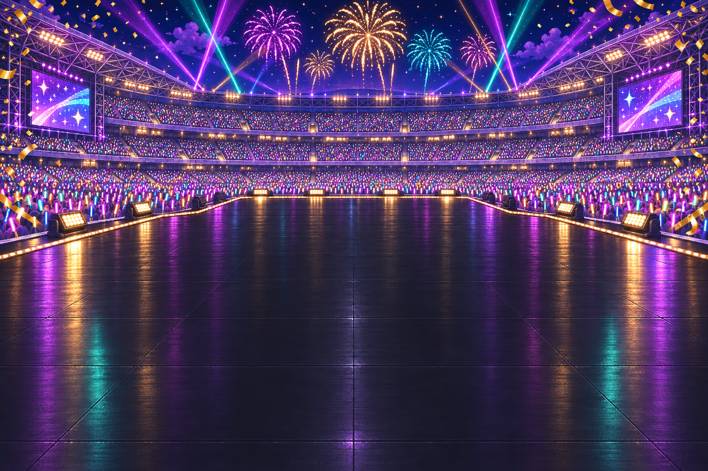

# 끝판왕 이벤트 이미지

그래미 노미네이트와 월드 스타디움 투어용 이미지 26장입니다. built-in image_gen으로 생성했으며 배경 2장과 캐릭터 6종 × 이벤트 2개 × 동작 2장의 투명 PNG를 분리했습니다.

게임의 그래미·스타디움 이벤트에 각각 grammy/stadium 전용 장면을 연결했습니다. 선택 화면, 전체 화면 축하 연출, 결과 화면에서 해당 배경과 사용자가 선택한 캐릭터의 2프레임을 사용합니다. 이벤트 발생 조건과 게임 수치는 유지했습니다.

## 배경

## 캐릭터 파일

|아바타|그래미 기본|그래미 인사|스타디움 노래|스타디움 환호|
|---|---|---|---|---|
|0 (여성)|[01](characters/avatar-0/grammy/01.png)|[02](characters/avatar-0/grammy/02.png)|[01](characters/avatar-0/stadium/01.png)|[02](characters/avatar-0/stadium/02.png)|
|1 (여성)|[01](characters/avatar-1/grammy/01.png)|[02](characters/avatar-1/grammy/02.png)|[01](characters/avatar-1/stadium/01.png)|[02](characters/avatar-1/stadium/02.png)|
|2 (여성)|[01](characters/avatar-2/grammy/01.png)|[02](characters/avatar-2/grammy/02.png)|[01](characters/avatar-2/stadium/01.png)|[02](characters/avatar-2/stadium/02.png)|
|3 (남성)|[01](characters/avatar-3/grammy/01.png)|[02](characters/avatar-3/grammy/02.png)|[01](characters/avatar-3/stadium/01.png)|[02](characters/avatar-3/stadium/02.png)|
|4 (남성)|[01](characters/avatar-4/grammy/01.png)|[02](characters/avatar-4/grammy/02.png)|[01](characters/avatar-4/stadium/01.png)|[02](characters/avatar-4/stadium/02.png)|
|5 (남성)|[01](characters/avatar-5/grammy/01.png)|[02](characters/avatar-5/grammy/02.png)|[01](characters/avatar-5/stadium/01.png)|[02](characters/avatar-5/stadium/02.png)|

그래미: 여성은 보석 자수의 롱드레스, 남성은 턱시도. 후보 지명 장면으로 트로피 없이 레드카펫 포즈 → 손 인사. 스타디움: 보석 장식 헤드라이너 의상과 마이크, 팔을 뻗어 노래 → 팔을 높여 관객 인사.

## 연결 정보와 검증

[ENDGAME-MANIFEST.json](ENDGAME-MANIFEST.json)에 전체 URL, 원본 크기, SHA-256, 투명 경계 및 footAnchor를 기록했습니다. 투명 여백을 유지하고 각 프레임의 발 위치와 가시 높이를 기준으로 배치하면 됩니다. 생성 이미지의 의상·비율에 미세한 프레임 차이가 있으므로 배치 후 실제 애니메이션 확인이 필요합니다.

[ENDGAME-PROMPTS.jsonl](ENDGAME-PROMPTS.jsonl)에 최종 프롬프트 전체, 참조 이미지, 생성 원본과 프로젝트 저장 경로가 있습니다. 별도의 API/CLI 없이 built-in image_gen만 사용했습니다.

검사 결과: 배경 2장, RGBA 투명 캐릭터 24장, 서로 다른 애니메이션 12쌍. alpha 범위 0–255, 외곽 alpha ≤2, 가시 콘텐츠 캔버스 접촉 없음. 모든 최종 이미지를 육안 확인했습니다.

